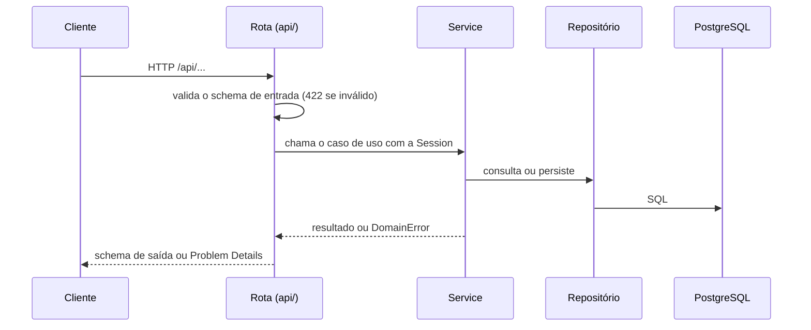

# Arquitetura do backend

API REST da Loja Virtual de Cupcakes Gourmet. Implementa o Model e o Controller do MVC e é consumida pelo frontend. A visão do sistema como um todo está em [Visão geral da arquitetura](../ARCHITECTURE.md).

## Princípios

- **Monolito modular**: um único processo e um único deploy, dividido em módulos de negócio com fronteiras explícitas.
- **Uma responsabilidade por arquivo**: cada arquivo contém uma rota, um service, um model, um schema ou um erro, com nome que descreve exatamente o que contém.
- **Dependências apontam para dentro**: rota depende de service, service depende de repositório, repositório depende de model. Nunca o contrário.
- **Ponto de entrada único**: `src/run.py` sobe o servidor; `app/main.py` monta a aplicação.
- **Configuração só por ambiente**: nenhum valor de conexão, segredo ou porta no código além dos padrões de desenvolvimento.

## Stack

| Item            | Escolha                                   | Motivo                                                             |
| --------------- | ----------------------------------------- | ------------------------------------------------------------------ |
| Linguagem       | Python 3.13                               | Aceita pelo enunciado do PIT                                       |
| Framework web   | FastAPI                                   | Validação por tipos e OpenAPI gerado                               |
| ORM e migrações | SQLAlchemy 2 (síncrono) e Alembic         | Síncrono por simplicidade; FastAPI roda rotas `def` em thread pool |
| Driver          | psycopg 3                                 | Funciona no Windows e aceita `sslmode` dos provedores              |
| Banco           | PostgreSQL 17                             | SGBD popular, exigido pelo enunciado                               |
| Configuração    | pydantic-settings                         | Variáveis tipadas e aninhadas por `__`                             |
| Testes          | pytest e `TestClient`                     | Unitários e de integração                                          |
| Qualidade       | Black (79 colunas) e Ruff                 | Formatação e lint; sem verificador de tipos, por decisão           |
| Dependências    | Poetry, com virtualenv em `backend/.venv` | Lock reprodutível                                                  |

## Estrutura de diretórios

```text
backend/
├── pyproject.toml              dependências e configuração de Black, Ruff, pytest
├── alembic.ini
├── alembic/
│   ├── env.py                  liga o Alembic a Settings e a Base
│   ├── script.py.mako          modelo das migrações
│   └── versions/               AAAAMMDD_HHMM_slug.py
├── src/
│   ├── run.py                  ponto de entrada
│   └── app/
│       ├── main.py             create_app: middleware, handlers, rotas, OpenAPI
│       ├── api_router.py       inclui o router de cada módulo sob /api
│       ├── shared/             infraestrutura sem regra de negócio
│       │   ├── config/         Settings
│       │   ├── database/       Base, engine e sessão por requisição
│       │   ├── errors/         DomainError e erros transversais (SYS)
│       │   ├── http/           Problem Details, handler único, problem_responses, OpenAPI
│       │   └── discovery.py    importação de models e errors por convenção
│       └── modules/
│           └── <módulo>/       ver "Anatomia de um módulo"
└── tests/
    ├── conftest.py
    ├── unit/<módulo>/
    └── integration/<módulo>/
```

## Módulos e cartões

Cada módulo corresponde a um conjunto de histórias de usuário de [Planejamento](../planning/README.md). O prefixo compõe os códigos de erro do módulo.

| Módulo       | Prefixo | Responsabilidade                                                    | Cartões                      |
| ------------ | ------- | ------------------------------------------------------------------- | ---------------------------- |
| `system`     | `SYS`   | Saúde da API e erros transversais                                   | —                            |
| `catalog`    | `CAT`   | Produtos, categorias, sabores, imagens, destaques e disponibilidade | US01, US02, US03, US13, US14 |
| `accounts`   | `ACC`   | Cadastro, autenticação, sessão e endereços de entrega               | US04, US05, US09             |
| `cart`       | `CRT`   | Carrinho do cliente e recálculo de totais                           | US06, US07                   |
| `orders`     | `ORD`   | Modalidade de recebimento, checkout, pagamento, status e encomendas | US08, US10, US11, US12, US15 |
| `promotions` | `PRM`   | Campanhas e combinações promocionais                                | US16                         |

Cada módulo é criado quando o primeiro cartão dele é implementado.

## Anatomia de um módulo

```text
modules/<módulo>/
├── api/
│   └── <recurso>_routes.py     Controller: define `router` e as rotas do recurso
├── schemas/
│   └── <contrato>.py           modelos Pydantic de entrada e saída
├── services/
│   └── <caso_de_uso>.py        uma regra de negócio por arquivo
├── repositories/
│   └── <entidade>_repository.py consultas e persistência de uma entidade
├── models/
│   └── <entidade>.py           entidade ORM
└── errors/
    └── <erro>.py               uma subclasse de DomainError por arquivo
```

| Camada          | Pode depender de                                                  | Nunca                                                            |
| --------------- | ----------------------------------------------------------------- | ---------------------------------------------------------------- |
| `api/`          | `schemas/`, `services/`, `shared/`                                | Acessar repositório ou model diretamente; lançar `HTTPException` |
| `services/`     | `repositories/`, `models/`, `errors/`, services de outros módulos | Conhecer `Request`, status HTTP ou schemas de resposta           |
| `repositories/` | `models/`, `errors/`                                              | Conter regra de negócio; chamar `commit`                         |
| `models/`       | `shared/database/`                                                | Importar camadas acima                                           |
| `schemas/`      | Pydantic                                                          | Importar models                                                  |

- Um módulo só usa outro módulo pelos seus **services**. Repositórios e models de outro módulo não são importados; chaves estrangeiras entre tabelas de módulos diferentes são permitidas.
- Todo router de módulo é registrado em `app/api_router.py`.
- Models e errors não precisam de registro: `import_submodules` os encontra pelo nome da pasta (`models`, `errors`).

## Fluxo de uma requisição



- `get_session` abre uma transação por requisição: confirma quando a rota retorna e desfaz quando algo é lançado. Services e repositórios nunca chamam `commit`.
- Um erro de domínio com `keeps_changes = True` confirma a transação antes de virar resposta de erro. É usado quando a falha precisa deixar rastro, como a contagem de tentativas de login inválidas.

## Autenticação

- `POST /api/accounts/sessions` troca e-mail e senha por um JWT (HS256) assinado com `AUTH__SECRET_KEY` e com expiração; o token carrega o id e o papel da conta.
- Rotas protegidas recebem `CurrentPrincipal` ou `AdminPrincipal` (`app/shared/http/authentication.py`), que validam o cabeçalho `Authorization: Bearer` sem consultar o banco.
- Senhas são guardadas com bcrypt; após `AUTH__MAX_FAILED_ATTEMPTS` falhas seguidas a conta fica bloqueada por `AUTH__LOCKOUT_MINUTES`.
- O administrador é criado pelo seed a partir de `ADMIN__EMAIL` e `ADMIN__PASSWORD`; não há cadastro público de administradores.
- Rotas são `def` (síncronas); o FastAPI as executa em thread pool.

## Pagamento

- O checkout fala com o meio de pagamento pela porta `PaymentGateway` (`modules/orders/services/payment_gateway.py`), injetada na rota por `get_payment_gateway`, o que permite trocar o provedor sem mudar o caso de uso.
- O MVP usa `SimulatedPaymentGateway`: Pix é aprovado na hora, dinheiro fica pendente até a entrega ou retirada e cartão é validado (Luhn, validade e CVV) e aprovado, exceto o número de teste terminado em `0002`, sempre recusado.
- O total é recalculado no servidor a partir do carrinho; o número do cartão nunca é gravado, só os quatro últimos dígitos na referência do pagamento.
- Pagamento recusado lança erro antes de qualquer gravação, então nenhum pedido fica criado e o carrinho é mantido.

## Persistência

- Todo model herda de `Base` (`app/shared/database/base.py`), cuja convenção de nomes gera nomes determinísticos para chaves, índices e restrições, o que mantém as migrações estáveis.
- Tabelas em inglês, `snake_case` e no plural (`products`, `order_items`); chave primária `id`; datas `created_at` e `updated_at` com fuso horário; valores monetários em `Numeric(10, 2)`.
- Migrações são geradas com `poetry run alembic revision --autogenerate -m "<descrição>"` e sempre revisadas antes do commit. O identificador é `AAAAMMDD_HHMM` (com segundos em caso de colisão) e o arquivo é `AAAAMMDD_HHMM_slug.py`.
- Uma migração aplicada em qualquer ambiente nunca é editada; corrige-se com uma nova.
- Migrações são sempre geradas pelo `autogenerate` e mantidas exatamente como saem dele; nunca são escritas nem ajustadas à mão. Se a saída gerada não passar no lint, corrige-se o modelo `alembic/script.py.mako`.
- Migrações só alteram esquema. Dados iniciais, como o catálogo de demonstração, são carregados por `src/seed.py`, idempotente: cada seed só insere quando o dado ainda não existe. A imagem o executa ao iniciar, salvo `RUN_SEED=false`.
- O CI aplica todas as migrações num banco limpo e roda `alembic check`, que falha se algum model não tiver migração.
- O projeto físico e o dicionário de dados exigidos pelo PIT devem refletir exatamente as migrações.

## Tratamento de erros

As regras obrigatórias resumidas ficam em `.claude/rules/error-handling.md`; esta seção explica o modelo.

### Erros de domínio com catálogo

- Todo erro de negócio é uma subclasse de `DomainError` com `code`, `status` e `title` como atributos de classe, declarada em `errors/` do módulo dono.
- O código segue `CS-<MOD>-<NNNN>`, com o prefixo da tabela de módulos. Números são sequenciais por módulo e nunca reaproveitados; um erro retirado recebe `deprecated = True`.
- `detail` é passado na instância e descreve a ocorrência em inglês (`"No product with id 42."`), sem expor SQL, tabelas, credenciais ou caminhos.
- Erros que nunca chegam ao HTTP declaram `internal = True`.
- O teste `tests/unit/shared/test_error_catalog.py` garante formato e unicidade de todos os códigos.

| Código        | Erro               | Status | Quando                                  |
| ------------- | ------------------ | ------ | --------------------------------------- |
| `CS-SYS-0001` | `UnexpectedError`  | 500    | Exceção não tratada                     |
| `CS-SYS-0002` | `InvalidRequest`   | 422    | Falha de validação do schema de entrada |
| `CS-SYS-0003` | `RouteNotFound`    | 404    | Caminho inexistente                     |
| `CS-SYS-0004` | `MethodNotAllowed` | 405    | Método HTTP não aceito pelo caminho     |
| `CS-SYS-0005` | `AuthenticationRequired` | 401 | Token ausente, inválido ou expirado |
| `CS-SYS-0006` | `AccessDenied`     | 403    | Conta sem o papel exigido pela rota     |

### Problem Details

Toda resposta de erro segue a RFC 9457, com `Content-Type: application/problem+json`, produzida apenas pelos handlers de `app/shared/http/exception_handlers.py`.

```json
{
  "type": "urn:cupcakes-store:problem:CS-SYS-0002",
  "title": "Invalid request",
  "status": 422,
  "code": "CS-SYS-0002",
  "instance": "/api/accounts",
  "errors": [
    { "pointer": "/body/email", "code": "missing", "detail": "Field required" }
  ]
}
```

- `status` no corpo é sempre igual ao da linha de estado.
- `errors` só aparece em `422`; cada entrada localiza o campo por JSON Pointer (RFC 6901) e traz o código do erro de validação.
- Uma exceção não tratada é registrada no log e respondida como `CS-SYS-0001`, sem mensagem interna.
- O frontend escolhe o texto exibido ao usuário pelo `code`; `title` e `detail` são voltados a quem desenvolve.

### Contrato de erro no OpenAPI

- Toda rota declara `responses=problem_responses(ErroA, ErroB)` com os erros que pode propagar; `UnexpectedError` entra sempre, automaticamente.
- Erros com o mesmo status são agrupados, cada um como exemplo nomeado em `application/problem+json`.
- O schema `ProblemDetails` é registrado nos componentes por `app/shared/http/openapi.py`.
- A documentação interativa fica em `/api/docs` e o documento em `/api/openapi.json`.

## Configuração

`Settings` (`app/shared/config/settings.py`) lê variáveis de ambiente e o arquivo `.env`, com grupos aninhados separados por `__` (`DATABASE__DSN`, `SERVER__PORT`). A tabela completa de variáveis e padrões está em [Visão geral da arquitetura](../ARCHITECTURE.md#configuração-por-ambiente). Rotas recebem as configurações por `Depends(get_settings)`, o que permite substituí-las em testes.

## Testes

- `tests/unit/` testa funções e services isolados; `tests/integration/` exercita a API pelo `TestClient`.
- A estrutura de pastas espelha os módulos (`tests/integration/catalog/...`).
- Todo erro de domínio declarado tem um teste de integração que percorre o caminho que o lança.
- Testes que precisam de banco usam o PostgreSQL de `docker/dev/` localmente e o serviço PostgreSQL no CI, com o mesmo `DATABASE__DSN`. Cada teste roda dentro de uma transação desfeita ao final (fixture `db_session`), por isso a suíte não deixa dados no banco de desenvolvimento.
- Cada critério de aceitação (CA) e regra de negócio (RN) do cartão vira ao menos um teste, o que alimenta a matriz requisito x caso de teste da Situação-Problema 3.

## Implementando um cartão

1. Ler o cartão em `docs/planning/cards/` e identificar o módulo dono.
2. Criar ou ajustar models e gerar a migração.
3. Declarar os erros de domínio previstos pelas regras de negócio.
4. Declarar schemas e a rota com `problem_responses`.
5. Escrever os testes de integração dos critérios de aceitação e dos caminhos de erro.
6. Implementar repositório e service até os testes passarem.
7. Atualizar o cartão (`status` e tabela de tarefas) no mesmo commit, com o código do cartão como âmbito.
