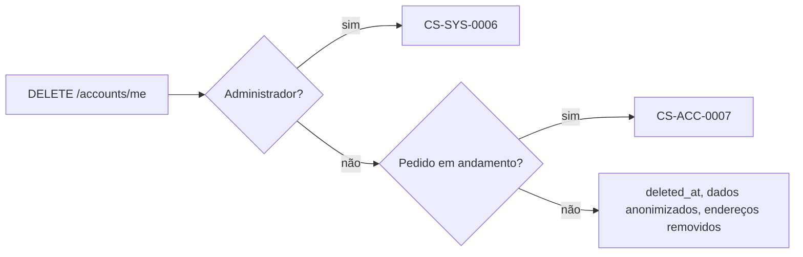

# Manutenção da própria conta

Atende à melhoria **IMP08** (editar os dados e excluir a própria conta), que amplia o perfil criado em **US04** e a sessão de **US05**. Todas as rotas exigem `CurrentPrincipal` e agem sempre sobre a conta do token (RNF#1).

## Rotas

| Rota                            | Resposta | Finalidade                                       |
| ------------------------------- | -------- | ------------------------------------------------ |
| `PUT /api/accounts/me`          | `200` com a conta | Substitui nome, e-mail e telefone       |
| `PUT /api/accounts/me/password` | `204`    | Troca a senha confirmando a atual                |
| `DELETE /api/accounts/me`       | `204`    | Exclui a conta de forma lógica                   |

## Edição dos dados

- O corpo usa os mesmos tipos do cadastro (`Name`, `EmailStr` de até 254 caracteres e `Phone`, de `schemas/contact_fields.py`), por isso as regras de [Cadastro de clientes](01_customer_registration.md) valem igualmente (CA#1).
- O novo e-mail é gravado em minúsculas e continua único (RN#1): manter o próprio e-mail é aceito; usar o de outra conta responde `CS-ACC-0001`, também quando duas requisições disputam o mesmo endereço, pela restrição única do banco.
- O frontend atualiza nome e e-mail guardados na sessão do navegador com a resposta.

## Troca de senha

- `current_password` precisa conferir com o hash armazenado; caso contrário, `CS-ACC-0006` e nada muda (CA#2).
- `new_password` segue a mesma política mínima do cadastro (RN#2), respondendo `CS-ACC-0002` quando fraca.
- A senha nunca volta em nenhuma resposta; só o novo hash bcrypt é gravado.

## Exclusão

- **Exclusão lógica (RN#3):** a linha de `users` permanece para que pedidos e encomendas continuem com seu cliente. `deleted_at` recebe o instante da exclusão, o nome passa a "Conta excluída", o e-mail vira `deleted-<id>@deleted.invalid`, o telefone fica vazio, a senha é trocada por um valor aleatório desconhecido e os endereços são apagados.
- **Pedidos em andamento (RN#4):** qualquer pedido fora de `completed` e `cancelled` impede a exclusão com `CS-ACC-0007`. A informação vem de `has_open_orders`, do módulo `orders`; a rota a consulta e a repassa ao caso de uso `delete_account`, o que mantém `accounts` sem depender de serviços de `orders` (que já depende de `accounts`).
- **Administrador:** a conta da loja não pode se excluir por esta rota (`CS-SYS-0006`).
- **Acesso negado depois (CA#4):** o login trata conta excluída como credencial inválida (`CS-ACC-0003`), e `GET /api/accounts/me` responde `CS-SYS-0005`. O frontend apaga a sessão assim que a exclusão é confirmada; um token emitido antes continua sem estado até expirar, sem dar acesso a dados pessoais, que já foram apagados.

## Componentes

| Camada        | Arquivo                                                |
| ------------- | ------------------------------------------------------ |
| Rotas         | `modules/accounts/api/account_routes.py`               |
| Edição        | `modules/accounts/services/update_account.py`          |
| Senha         | `modules/accounts/services/change_password.py`         |
| Exclusão      | `modules/accounts/services/delete_account.py`          |
| Pedidos abertos | `modules/orders/services/customer_orders.py` (`has_open_orders`) |
