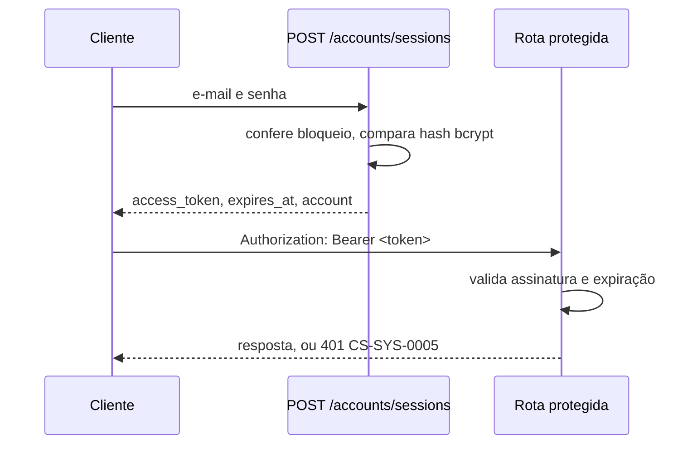

# Desenho da autenticação

Atende ao cartão **US05** (acessar a conta de forma segura) e protege as rotas de carrinho, endereços, pedidos e administração.

## Modelo

- Autenticação **sem estado** por token JWT assinado com HS256 e a chave `AUTH__SECRET_KEY`.
- O token carrega o id da conta (`sub`), o papel (`role`) e a expiração (`exp`); não há tabela de sessões.
- A validade padrão é de 120 minutos (`AUTH__ACCESS_TOKEN_MINUTES`). Expirado o token, toda rota protegida responde `CS-SYS-0005` e o cliente precisa entrar de novo (US05, RN#2).

## Login

`POST /api/accounts/sessions` recebe `email` e `password` e responde `201` com:

| Campo          | Conteúdo                                          |
| -------------- | ------------------------------------------------- |
| `access_token` | JWT a enviar em `Authorization: Bearer`           |
| `token_type`   | Sempre `bearer`                                   |
| `expires_at`   | Instante em que o token deixa de valer            |
| `account`      | Id, nome, e-mail, telefone, papel e data de cadastro |

O e-mail é comparado sem diferenciar maiúsculas. Credenciais erradas respondem `CS-ACC-0003` sem revelar se o e-mail existe.

## Autorização nas rotas

As dependências ficam em `app/shared/http/authentication.py` e não consultam o banco:

| Dependência        | Exige                     | Erros                         |
| ------------------ | ------------------------- | ----------------------------- |
| `CurrentPrincipal` | Token válido              | `CS-SYS-0005`                 |
| `AdminPrincipal`   | Token válido e papel `admin` | `CS-SYS-0005`, `CS-SYS-0006` |

Os routers administrativos (`/catalog/admin`, `/orders/admin`, `/promotions/admin`) aplicam `admin_principal` ao router inteiro, de forma que nenhuma rota nova do painel fique aberta por esquecimento.

## Papéis

| Papel      | Como é criado                                   | Alcance                                 |
| ---------- | ----------------------------------------------- | --------------------------------------- |
| `customer` | Cadastro público (US04)                         | Vitrine, carrinho, pedidos e encomendas próprios |
| `admin`    | Seed a partir de `ADMIN__EMAIL` e `ADMIN__PASSWORD` | Tudo do cliente mais o painel da loja |

Não existe cadastro público de administradores. O seed também promove a `admin` uma conta já existente com o e-mail configurado.

## Isolamento entre clientes

Recursos do cliente são sempre buscados pelo id da conta presente no token, nunca por um id vindo da requisição. Pedidos e endereços de outra pessoa respondem como inexistentes (`CS-ORD-0006`, `CS-ACC-0005`), sem confirmar que o recurso existe (US11, RN#1).

Contas excluídas pelo cliente (IMP08) têm `deleted_at` preenchido: o login as trata como credencial inválida e `GET /api/accounts/me` responde `CS-SYS-0005`; ver [Manutenção da própria conta](../accounts/03_account_self_service.md).

Proteções de senha, bloqueio por tentativas e demais medidas estão em [Estratégia de segurança](02_security_strategy.md).
