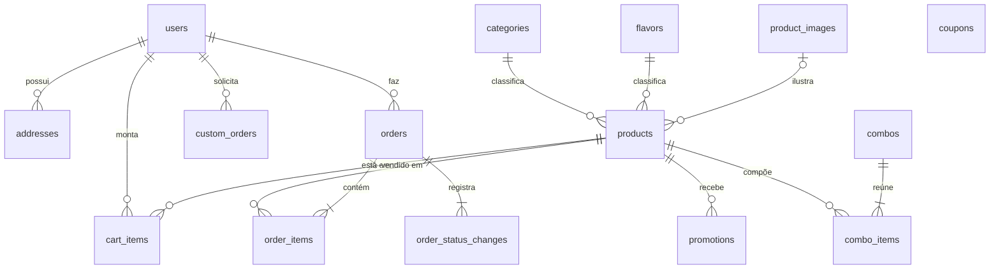

# Modelo de dados

Projeto físico do banco PostgreSQL, gerado exclusivamente pelas migrações do Alembic. O detalhe de cada coluna está no [dicionário de dados](02_data_dictionary.md).

## Diagrama entidade-relacionamento

## Tabelas por módulo

| Módulo       | Tabelas                                                        | Cartões                       |
| ------------ | -------------------------------------------------------------- | ----------------------------- |
| `catalog`    | `categories`, `flavors`, `product_images`, `products`          | US01, US02, US03, US13, US14  |
| `accounts`   | `users`, `addresses`                                           | US04, US05, US09              |
| `cart`       | `cart_items`                                                   | US06, US07                    |
| `orders`     | `orders`, `order_items`, `order_status_changes`, `custom_orders` | US08, US10, US11, US12, US15 |
| `promotions` | `promotions`, `combos`, `combo_items`, `coupons`               | US16, IMP06                   |

## Decisões de modelagem

- **Preços congelados no pedido:** `order_items` copia nome e preço unitário do produto, e `orders` grava subtotal, desconto de combos, código e desconto do cupom, taxa e total; o código do cupom é copiado como texto, sem chave estrangeira, para que excluir um cupom não altere pedidos. Mudanças posteriores no catálogo não alteram pedidos já feitos.
- **Endereço como cópia:** o pedido guarda o endereço de entrega em texto (`delivery_address`), e não uma chave para `addresses`; o cliente pode editar ou excluir endereços sem afetar o histórico.
- **Inativação em vez de exclusão:** produtos têm `is_active`; nunca são apagados, para preservar pedidos e carrinhos que os referenciam.
- **Histórico de status:** cada mudança gera uma linha em `order_status_changes`, inclusive o recebimento no checkout.
- **Encomendas separadas:** `custom_orders` não compartilha tabela com `orders`, porque tem fluxo, campos e aprovação próprios.
- **Imagens no banco:** `product_images.data` guarda os bytes, já que a hospedagem gratuita não oferece disco persistente.
- **Carrinho por usuário:** não há tabela de carrinho; a unicidade `(user_id, product_id)` em `cart_items` garante uma linha por produto.
- **Exclusão em cascata** só onde o dado pertence ao dono: endereços e itens de carrinho somem com o usuário; itens, histórico e itens de combo somem com o pedido ou combo.

## Convenções físicas

- Nomes em inglês, `snake_case`, tabelas no plural, chave primária `id` inteira.
- Datas com fuso (`timestamptz`); `created_at` e `updated_at` preenchidos pelo banco.
- Valores monetários em `numeric(10, 2)`.
- Restrições com nomes determinísticos (`pk_`, `fk_`, `uq_`, `ix_`), definidos pela convenção de `Base`.

## Histórico de migrações

| Revisão           | Descrição                                   | Cartão |
| ----------------- | ------------------------------------------- | ------ |
| `20261018_1617`   | Tabelas do catálogo                         | US01   |
| `20261018_1624`   | Composição e diferenciais do produto        | US03   |
| `20261018_1628`   | Tabela de usuários                          | US04   |
| `20261018_1633`   | Bloqueio de login nos usuários              | US05   |
| `20261018_1641`   | Itens de carrinho                           | US06   |
| `20261018_1645`   | Visibilidade de produto indisponível        | US14   |
| `20261018_1647`   | Endereços                                   | US09   |
| `20261018_1653`   | Pedidos e itens de pedido                   | US10   |
| `20261018_1655`   | Histórico de status de pedido               | US11   |
| `20261018_1701`   | Encomendas especiais                        | US12   |
| `20261018_1706`   | Promoções, combos e desconto no pedido      | US16   |
| `20261025_1420`   | Cupons e cupom aplicado no pedido           | IMP06  |
| `20261025_1438`   | Exclusão lógica de usuários                 | IMP08  |

Migrações são sempre geradas por `alembic revision --autogenerate` e nunca editadas à mão; o CI confere com `alembic check` que nenhum model ficou sem migração.
