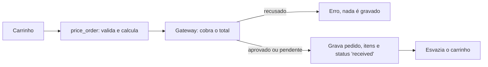

# Checkout e pagamento

Atende ao cartão **US10** (finalizar a compra com segurança).

## Checkout — `POST /api/orders`

| Campo                | Regra                                                        |
| -------------------- | ------------------------------------------------------------ |
| `fulfillment_method` | `pickup` ou `delivery`                                       |
| `address_id`         | Obrigatório na entrega                                       |
| `payment_method`     | `pix`, `credit_card` ou `cash`                               |
| `card`               | Obrigatório para cartão: número, nome, mês, ano e CVV        |
| `notes`              | Observações livres, até 500 caracteres                       |

Responde `201` com o pedido criado, seus itens e o histórico inicial.

## Regras de negócio

| Regra                                                             | Implementação                                       |
| ----------------------------------------------------------------- | --------------------------------------------------- |
| CA#1: resumo final dos itens                                      | Itens gravados com nome e preço do momento          |
| CA#2: total com eventual taxa de entrega                          | Mesmo cálculo da [cotação](01_fulfillment_and_quote.md) |
| CA#3: escolher pagamento e confirmar                              | `payment_method` e confirmação única               |
| RN#1: só com carrinho válido e modalidade definida                | `CS-ORD-0002`, `CS-ORD-0003`, `CS-ORD-0001`         |
| RN#2: valor final igual aos itens ativos, quantidades e taxa      | Total recalculado no servidor; nenhum valor vem do cliente |
| RNF#1: fluxo seguro e consistente                                 | Uma transação; pagamento recusado desfaz tudo       |

## Pagamento

O checkout conversa com o meio de pagamento pela porta `PaymentGateway`, injetada na rota por `get_payment_gateway`. Trocar de provedor exige apenas um novo adaptador. O MVP usa `SimulatedPaymentGateway`:

| Forma         | Resultado                                                                 | Referência gravada  |
| ------------- | ------------------------------------------------------------------------- | ------------------- |
| `pix`         | Aprovado na hora                                                          | `PIX-<código>`      |
| `cash`        | Pendente; passa a aprovado quando o pedido é concluído                    | `CASH`              |
| `credit_card` | Validado e aprovado; números terminados em `0002` são sempre recusados    | `CARD-****<final>`  |

Validação do cartão: número de 13 a 19 dígitos com dígito verificador (Luhn) correto, CVV de 3 ou 4 dígitos e validade não vencida. Falhas respondem `CS-ORD-0004`; recusa da operadora, `CS-ORD-0005` (HTTP 402).

Cartões para teste: `4111 1111 1111 1111` é aprovado; `4000 0000 0000 0002` é recusado.

## Garantias

- O pagamento acontece antes de qualquer gravação. Se ele falhar, nenhum pedido existe e o carrinho continua intacto.
- O carrinho só é esvaziado depois que o pedido foi gravado, dentro da mesma transação.
- O pedido guarda subtotal, desconto de combos, cupom e desconto do cupom, taxa, total, itens e endereço como estavam no momento da compra (IMP06).
