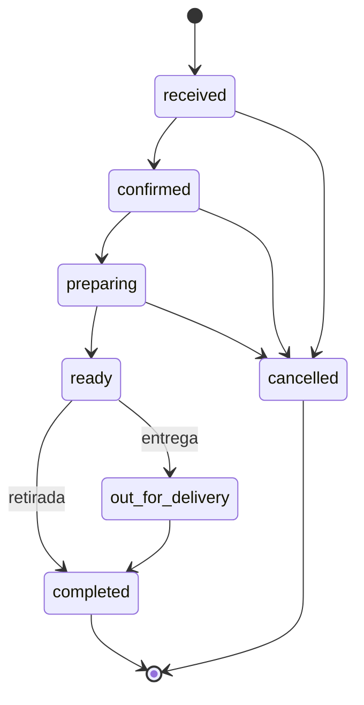

# Ciclo de vida e acompanhamento do pedido

Atende aos cartões **US11** (acompanhar o pedido) e **US15** (gerenciar os pedidos da loja).

## Status

| Status             | Significado                           |
| ------------------ | ------------------------------------- |
| `received`         | Pedido recebido no checkout           |
| `confirmed`        | Aceito pela loja                      |
| `preparing`        | Em preparo                            |
| `ready`            | Pronto para retirada ou envio         |
| `out_for_delivery` | Em rota de entrega (só entrega)       |
| `completed`        | Entregue ou retirado                  |
| `cancelled`        | Cancelado pela loja                   |

## Máquina de estados

- A sequência depende da modalidade: retirada nunca passa por `out_for_delivery`, e entrega não vai de `ready` direto para `completed`.
- Um pedido só pode ser cancelado antes de ficar pronto.
- Qualquer passo fora do diagrama responde `CS-ORD-0007` (US15, RN#1 e RN#2).
- Ao concluir um pedido pago em dinheiro, o pagamento passa a `approved`.

## Histórico

Cada mudança, inclusive o recebimento no checkout, grava uma linha em `order_status_changes` com o status e o momento (US11, RN#2). O histórico acompanha todas as respostas de pedido.

## Acompanhamento pelo cliente (US11)

| Rota                      | Conteúdo                                               |
| ------------------------- | ------------------------------------------------------ |
| `GET /api/orders`         | Pedidos do cliente, mais recentes primeiro             |
| `GET /api/orders/{id}`    | Status atual, data de criação, histórico, itens, valores, modalidade e pagamento |

- CA#1 e CA#3: status atual e etapas de pronto, em rota e concluído.
- CA#2: `created_at` com data e hora.
- RN#1: pedido de outro cliente responde `CS-ORD-0006`, como se não existisse.

## Painel operacional (US15)

Rotas em `/api/orders/admin`, com papel `admin`:

| Rota                           | Conteúdo                                                       |
| ------------------------------ | -------------------------------------------------------------- |
| `GET /`                        | Pedidos, mais recentes primeiro; filtro opcional `status`      |
| `GET /{order_id}`              | Pedido completo                                                |
| `PATCH /{order_id}/status`     | Avança o pedido para `status`                                  |

Cada pedido do painel traz, além dos dados do cliente comum, o contato do cliente (nome, e-mail e telefone) e `next_statuses`, a lista exata de próximos passos permitidos. O painel mostra apenas esses botões, o que torna a operação clara no dia a dia (RNF#1) e impede passos inválidos já na interface.

| Critério                                                    | Atendimento                                  |
| ----------------------------------------------------------- | -------------------------------------------- |
| CA#1: pedidos com dados do cliente e do pedido              | Listagem com contato, itens e valores        |
| CA#2: atualizar o status ao longo do fluxo                  | `PATCH /{order_id}/status`                   |
| CA#3: modalidade e observações do cliente                   | `fulfillment_method`, endereço e `notes`     |
