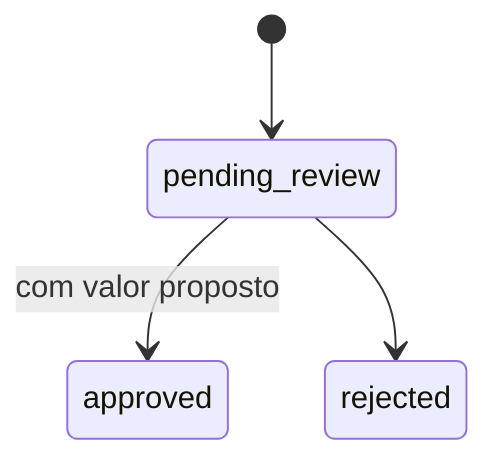

# Encomendas especiais

Atende ao cartão **US12** (solicitar encomenda personalizada).

## Solicitação pelo cliente

| Rota                       | Finalidade                          |
| -------------------------- | ----------------------------------- |
| `POST /api/orders/custom`  | Cria a solicitação                  |
| `GET /api/orders/custom`   | Lista as solicitações do cliente, mais recentes primeiro |

| Campo          | Regra                                   |
| -------------- | --------------------------------------- |
| `description`  | O que o cliente deseja, de 10 a 1000 caracteres |
| `quantity`     | De 6 a 500 unidades                     |
| `desired_date` | Data desejada, com antecedência mínima  |
| `notes`        | Observações, até 500 caracteres         |

Toda solicitação nasce com status `pending_review`.

## Análise pela loja

| Rota                                                 | Finalidade                                   |
| ---------------------------------------------------- | -------------------------------------------- |
| `GET /api/orders/admin/custom`                       | Solicitações por data desejada; filtro `status` |
| `PATCH /api/orders/admin/custom/{id}/review`         | Decide a solicitação                         |

A decisão informa `decision` (`approved` ou `rejected`), `quoted_price` (obrigatório na aprovação) e `response`, a mensagem para o cliente. A listagem do painel inclui o contato do cliente.

## Regras de negócio

| Regra                                                     | Implementação                                   | Erro          |
| --------------------------------------------------------- | ----------------------------------------------- | ------------- |
| CA#1: quantidade, data e observações                      | Schema `CustomOrderInput`                       | `CS-SYS-0002` |
| CA#2: registro separado do pedido comum                   | Tabela própria `custom_orders`                  | —             |
| CA#3: análise e aprovação pela loja                       | Rota de revisão no painel                       | —             |
| RN#1: antecedência mínima definida pela loja              | `desired_date >= hoje + STORE__CUSTOM_ORDER_LEAD_DAYS` (padrão 2) | `CS-ORD-0008` |
| RN#2: validação manual antes da confirmação               | Status `pending_review` até a decisão           | —             |
| Aprovação exige valor                                     | Validação do schema de revisão                  | `CS-SYS-0002` |
| Decisão única                                             | Só solicitações pendentes podem ser decididas   | `CS-ORD-0010` |

A encomenda aprovada fica registrada com valor e resposta; o combinado de pagamento e entrega acontece no contato direto entre loja e cliente, fora do fluxo de checkout.
