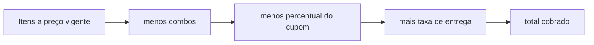

# Cupons de desconto

Atende à melhoria **IMP06** (aplicar cupom de desconto no checkout), que amplia as campanhas de **US16** e o checkout de **US10**.

## Recurso

Um cupom é um código com percentual de desconto e período de vigência, mantido pelo administrador no módulo `promotions`. A vigência segue a mesma regra das [campanhas e combos](01_campaigns_featured_and_combos.md#vigência): o cupom vale quando está habilitado (`is_active`) e o instante atual está em `[starts_at, ends_at)`.

| Campo              | Regra                                                                    |
| ------------------ | ------------------------------------------------------------------------ |
| `code`             | De 3 a 30 caracteres entre letras, números, `-` e `_`; gravado em maiúsculas e único |
| `discount_percent` | Inteiro de 1 a 100                                                       |
| `starts_at`, `ends_at` | Datas com fuso; o fim precisa ser posterior ao início                |
| `is_active`        | Liga ou desliga o cupom sem alterar os demais dados                      |

## Rotas

| Rota                                                   | Acesso  | Finalidade                                    |
| ------------------------------------------------------ | ------- | --------------------------------------------- |
| `GET /api/promotions/admin/coupons`                    | Admin   | Lista os cupons com `is_running`              |
| `POST /api/promotions/admin/coupons`                   | Admin   | Cria um cupom                                 |
| `PUT /api/promotions/admin/coupons/{coupon_id}`        | Admin   | Substitui um cupom                            |
| `PATCH /api/promotions/admin/coupons/{coupon_id}/active` | Admin | Ativa ou desativa (`{"is_active": false}`)    |
| `DELETE /api/promotions/admin/coupons/{coupon_id}`     | Admin   | Exclui; pedidos já feitos guardam código e desconto |
| `POST /api/orders/quote` e `POST /api/orders`          | Cliente | Aceitam `coupon_code` opcional                |

## Cálculo no pedido

- O percentual incide sobre os itens já com preços promocionais e descontos de combos (RN#3), arredondado ao centavo; a taxa de entrega nunca é descontada (RN#2). Com 100%, o pedido de retirada fica com total zero e o de entrega paga só a taxa.
- `coupon_code` vazio ou só com espaços é tratado como ausência de cupom; o código digitado é comparado sem diferenciar maiúsculas (RN#1).
- Apenas um cupom por pedido (RN#3): o campo é único.
- A cotação e o checkout usam o mesmo `price_order`, que chama `apply_coupon` do módulo `promotions`. O desconto é sempre recalculado pela API na confirmação; valores de desconto ou total enviados pelo cliente são ignorados (RN#4).
- O pedido grava `coupon_code` e `coupon_discount` (CA#4), separados de `discount`, que continua sendo o desconto de combos. Ambos aparecem no acompanhamento (US11) e no painel de pedidos (US15).

| Campo de saída (cotação e pedido) | Conteúdo                                      |
| --------------------------------- | --------------------------------------------- |
| `coupon_code`                     | Código aplicado, em maiúsculas, ou nulo       |
| `coupon_discount`                 | Valor descontado pelo cupom, ou `0.00`        |
| `total`                           | `subtotal - discount - coupon_discount + delivery_fee` |

## Erros

| Situação                                         | Erro          |
| ------------------------------------------------ | ------------- |
| Cupom inexistente, desativado ou fora da vigência | `CS-PRM-0007` |
| Código já usado por outro cupom                  | `CS-PRM-0006` |
| Cupom inexistente na manutenção                  | `CS-PRM-0005` |
| Fim da vigência igual ou anterior ao início      | `CS-PRM-0001` |

Um cupom recusado não impede o pedido: basta confirmar sem ele (CA#3).

## Dados iniciais

Com `SEED__DEMO_CATALOG=true`, o seed cria o cupom `BEMVINDO10` (10%, válido por um ano a partir da carga) quando nenhum cupom usa esse código; ver [Dados iniciais](../database/03_seed_data.md).

## Componentes

| Camada            | Arquivo                                                   |
| ----------------- | --------------------------------------------------------- |
| Rotas             | `modules/promotions/api/promotion_routes.py`              |
| Manutenção        | `modules/promotions/services/manage_coupons.py`           |
| Desconto no pedido | `modules/promotions/services/coupon_discount.py`         |
| Persistência      | `modules/promotions/repositories/coupon_repository.py`    |
| Cotação           | `modules/orders/services/price_order.py`                  |
