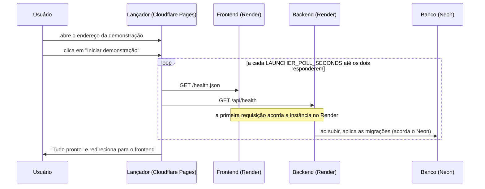

# Arquitetura do lançador

Página de entrada da demonstração da Loja Virtual de Cupcakes Gourmet. É o endereço divulgado para quem vai usar ou avaliar o sistema: ela acorda os serviços hospedados no Render, acompanha a inicialização e só então leva o usuário à loja. A visão do sistema como um todo está em [Visão geral da arquitetura](../ARCHITECTURE.md).

## Motivação e decisão

O projeto é acadêmico e usa planos gratuitos: backend e frontend como imagens no Render e banco no Neon. No Render, uma instância gratuita hiberna após um período sem tráfego e leva de um a alguns minutos para voltar. Quem abre a loja nesse momento vê erro de proxy ou página em branco, e o frontend acordado sozinho ainda depende da API, que também pode estar dormindo.

A decisão foi publicar um terceiro componente, o lançador, que nunca hiberna:

| Opção considerada                                   | Por que não                                                                  |
| --------------------------------------------------- | ---------------------------------------------------------------------------- |
| Divulgar o endereço do frontend direto              | O primeiro acesso falha ou demora sem nenhum retorno ao usuário              |
| Plano pago ou ping periódico para manter acordado   | Custo, ou consumo das horas gratuitas do Render sem ninguém usando           |
| Tela de espera dentro do próprio frontend           | O frontend também hiberna; a tela só apareceria depois de ele já ter subido  |
| **Página estática no Cloudflare Pages (escolhida)** | Sempre no ar, gratuita, sem servidor; acorda os dois serviços sob demanda    |

## Fluxo



- A inicialização só começa no clique, para que robôs e pré-visualizações de links não acordem os serviços à toa.
- As duas verificações correm em paralelo; cada uma tem tempo limite de `LAUNCHER_REQUEST_TIMEOUT_SECONDS`, para que uma requisição presa durante o despertar não atrase o ciclo.
- Um serviço só conta como disponível quando responde `200` com o corpo `{"status": "ok"}`. A página de espera que o Render devolve durante o despertar (`503` ou HTML) conta como "Iniciando".
- Quando os dois estão disponíveis, a página mostra "Tudo pronto" e redireciona para `LAUNCHER_FRONTEND_URL`; um botão "Entrar na loja" fica visível caso o redirecionamento seja bloqueado.
- A barra de progresso é uma estimativa por tempo decorrido (90 segundos esperados, travada em 95% até a confirmação). Após 3 minutos aparece um aviso de demora, e as verificações continuam.

## O que cada verificação prova

| Serviço           | Endereço verificado          | Quem responde                                                                                 | CORS                                                         |
| ----------------- | ---------------------------- | --------------------------------------------------------------------------------------------- | ------------------------------------------------------------ |
| Frontend          | `<frontend>/health.json`     | Arquivo estático `frontend/public/health.json`, servido pelo nginx da imagem                  | `Access-Control-Allow-Origin: *`, definido no nginx          |
| API e banco       | `<backend>/api/health`       | Rota de saúde do backend                                                                      | Origem do lançador incluída em `CORS__ALLOW_ORIGINS`         |

- O nginx do frontend atende `/health.json` sem cache, então a resposta prova que o contêiner está de pé.
- `/api/health` não consulta o banco, mas a imagem do backend aplica as migrações antes de servir (`RUN_MIGRATIONS=true`); se o backend responde, ele já conectou ao Neon e o despertou.

## Estrutura de diretórios

```text
launcher/
├── package.json        scripts build, serve e test; sem dependências
├── .env.example        modelo das variáveis para uso local
├── src/                página publicada, sem etapa de compilação
│   ├── index.html
│   ├── styles.css      mesma identidade visual da loja
│   ├── app.js          interface: passos, contador, selos e redirecionamento
│   ├── status.js       regras puras: verificação com tempo limite, estados e progresso
│   └── favicon.svg
├── scripts/
│   ├── config.mjs      lê e valida as variáveis e gera o módulo de configuração
│   ├── build.mjs       copia src/ para dist/ e grava dist/config.js
│   └── serve.mjs       servidor estático mínimo para testar localmente
└── test/               testes com node:test
```

- HTML, CSS e JavaScript puros: a página é pequena, não precisa de framework e carrega rápido mesmo em conexões lentas.
- Não há imagem Docker. O lançador não participa do release das imagens nem do versionamento em lockstep; ele é publicado pelo Cloudflare Pages a cada push.

## Configuração

As variáveis são lidas no build, do ambiente ou de `launcher/.env`, e gravadas em `dist/config.js`. Mudar um valor exige novo build (no Cloudflare Pages, um novo deploy).

| Variável                           | Padrão local            | Uso                                                       |
| ---------------------------------- | ----------------------- | --------------------------------------------------------- |
| `LAUNCHER_FRONTEND_URL`            | `http://localhost:5173` | Endereço da loja; destino do redirecionamento             |
| `LAUNCHER_BACKEND_URL`             | `http://localhost:8000` | Endereço da API, sem o `/api`                             |
| `LAUNCHER_POLL_SECONDS`            | `10`                    | Intervalo entre verificações                              |
| `LAUNCHER_REQUEST_TIMEOUT_SECONDS` | `8`                     | Tempo máximo de espera de cada verificação                |

O build falha se uma URL for inválida ou um número não for positivo, para que uma configuração errada nunca seja publicada.

## Publicação e diagnóstico

A configuração do projeto no Cloudflare Pages e dos serviços no Render está em [Publicação no Cloudflare Pages](operations/01_cloudflare_deployment.md); problemas comuns e como identificá-los estão em [Diagnóstico](operations/02_troubleshooting.md).

## Execução local

1. Subir banco, backend e frontend como descrito na [visão geral](../ARCHITECTURE.md#execução-local).
2. Em `launcher/`: copiar `.env.example` para `.env`, rodar `npm run build` e `npm run serve`, e acessar `http://localhost:4173`.

O padrão de `CORS__ALLOW_ORIGINS` do backend já inclui `http://localhost:4173`, e o Vite libera CORS para origens locais.

## Testes

`npm test` roda os testes com `node:test`, sem dependências: a verificação de saúde (resposta válida, página de espera, falha de rede e tempo limite), as regras de estado e progresso, e a leitura e validação da configuração. O CI roda testes e build quando `launcher/` muda.
